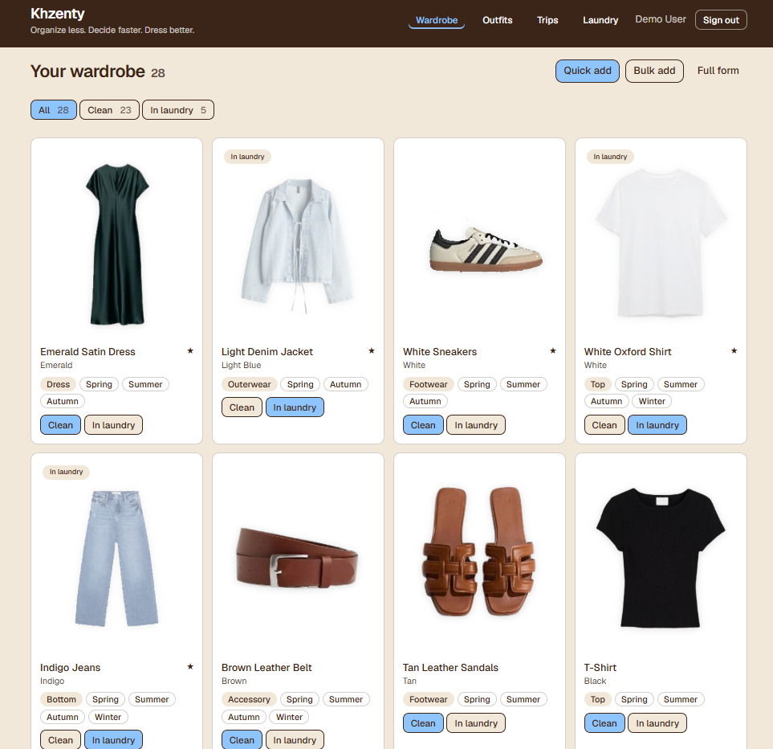
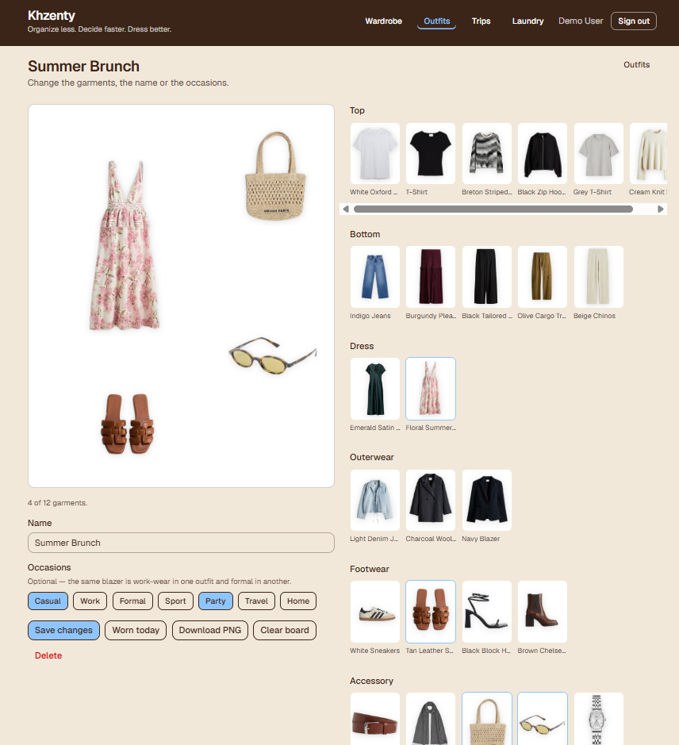
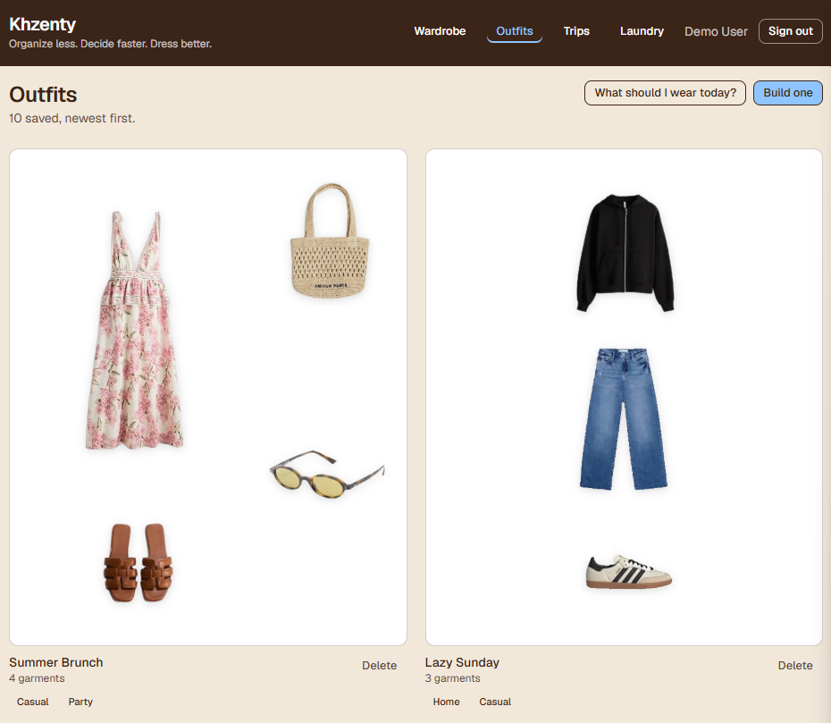
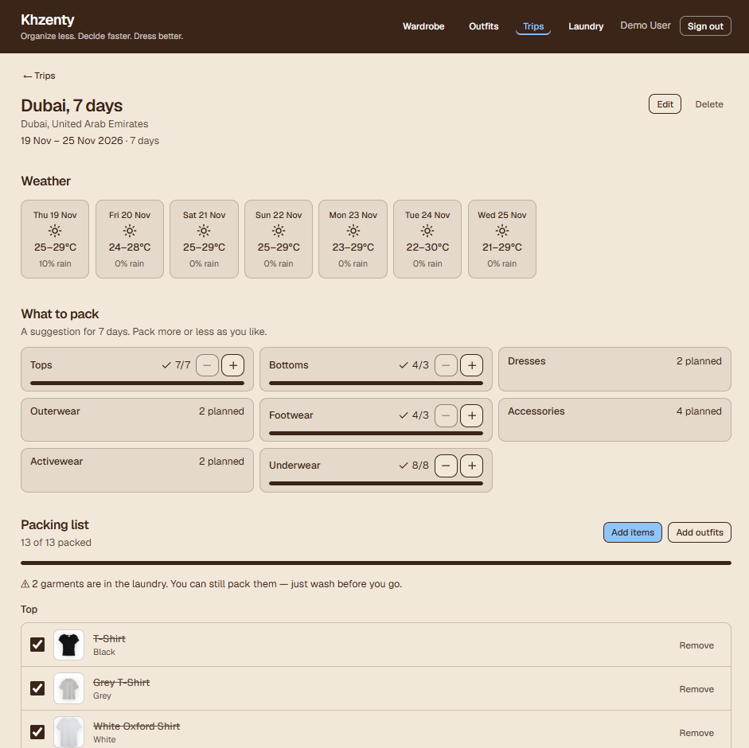
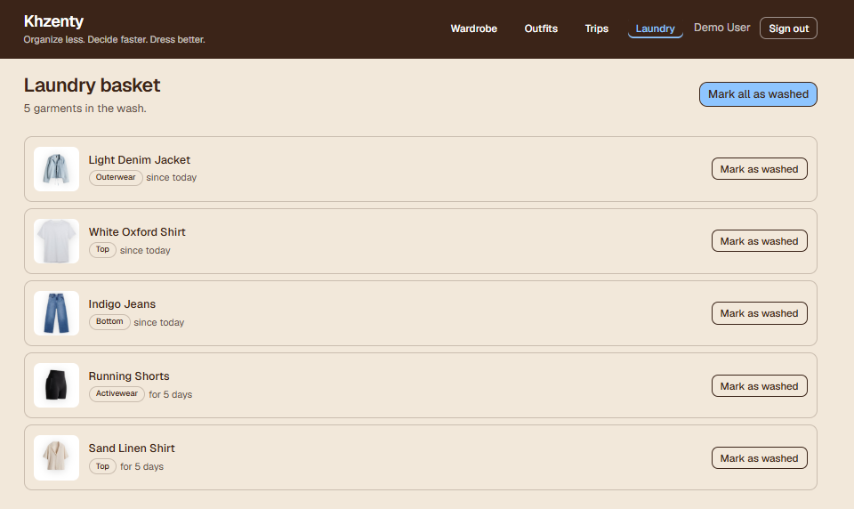
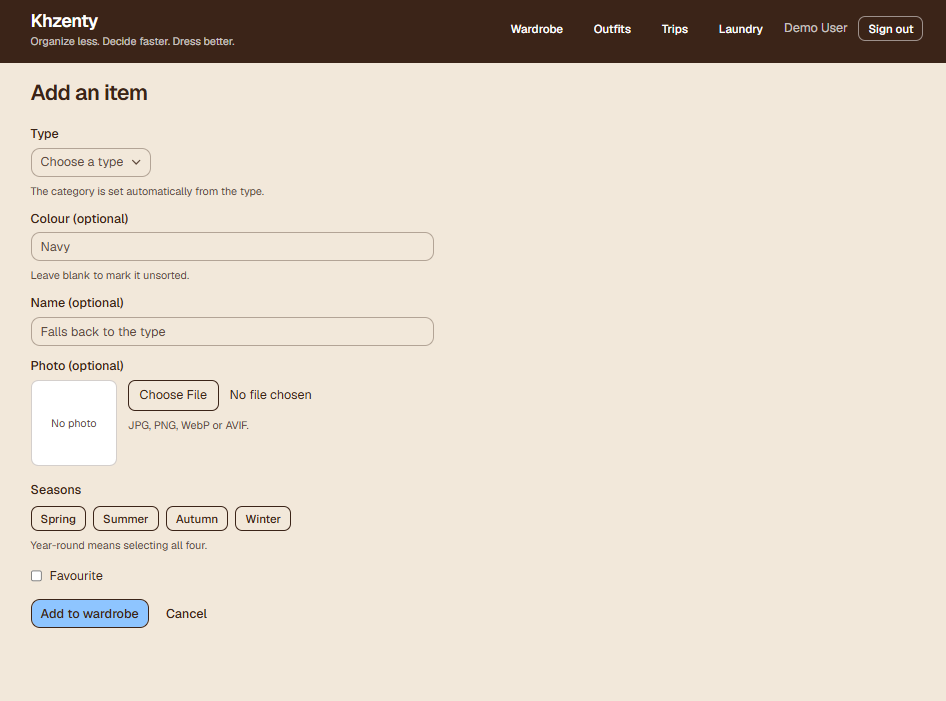
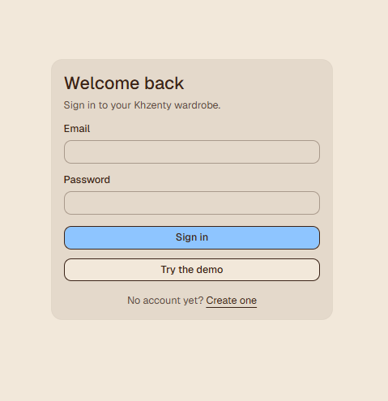
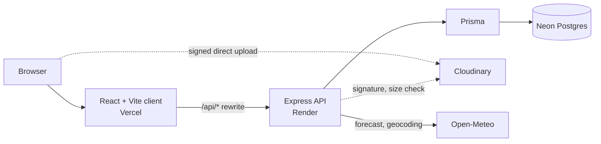

# Khzenty

> Organize less. Decide faster. Dress better.

[](https://github.com/mounasmiri/khzenty/actions/workflows/ci.yml)
[](LICENSE)

### [Live demo: khzenty.vercel.app](https://khzenty.vercel.app)

Tap **Try the demo**. No signup: you get a private copy that is deleted after 24 hours.

> **Cold start.** The app runs on free hosting. The first load after a quiet period can take 30–60 seconds while the API wakes up; reloading after a minute works.

Most people wear a fraction of what they own, because they cannot remember the rest. Khzenty is a wardrobe assistant for rediscovering the clothes you already have: photograph them once, turn them into clean cutouts, combine them into outfits on a board, log what you wear, and plan what to pack for a trip. It is not a shopping app and not a social network.

## Screenshots

| | |
|:---:|:---:|
|  |  |
| **Wardrobe**: photo cutouts, filters, favourites | **Outfit builder**: pick pieces, get an automatic layout |
|  |  |
| **Outfits**: saved boards, worn today | **Trip**: packing list, forecast, pack-for-N-days guidance |
|  |  |
| **Laundry**: what is in the basket | **Add an item**: photo, type, season |
|  | |
| **Login**: with the "Try the demo" button | |

## Features

- **Wardrobe** with photo cutouts: optional background removal that runs in the browser, with a before/after preview
- **Fast capture**: quick add (camera on mobile), bulk add, and a quick-sort screen for photo-only drafts
- **Laundry tracking**: a manual Clean / In laundry status, a laundry basket and "mark as washed"
- **Outfit builder**: boards laid out automatically (top, bottom, shoes, bag, accessories), saved with occasions, exportable as a PNG
- **Wear log with undo**: "Worn today" moves the clean pieces to the laundry, and undo restores exactly what it changed
- **What should I wear today?** picks a saved outfit whose pieces are all clean
- **Travel packing**: trips with a checklist, a per-day weather forecast, and pack-for-N-days guidance per category
- **Per-visitor private demo sandbox**: every demo visitor gets their own temporary copy of a sample account

## Architecture



The browser only talks to the Vercel origin. Vercel serves the client and rewrites `/api/*` to the Express API, so the session cookie is same-origin and there is no CORS. Image bytes go from the browser straight to Cloudinary, and only the server calls Open-Meteo.

**Backend layering:** Route → Controller → Service → Prisma. Routes are the HTTP surface, controllers are thin (read the request, delegate, shape the response), services hold the business logic and know nothing about `req`/`res`, and Prisma is the only code that touches the database. See [`docs/ARCHITECTURE.md`](docs/ARCHITECTURE.md) for the data model and sequence diagrams.

## Key decisions and trade-offs

- **Rule-based guidance, not AI, by design.** Pack-for-N-days is a pure function with every number in one `PACKING_RULES` object. It is deterministic, unit-testable and explainable. The trade-off is that it is simple: it counts items per category and does not understand style. AI suggestions are on the roadmap.
- **Direct-to-Cloudinary signed uploads.** The API only issues a short-lived signature covering the folder and allowed formats, so image bytes never pass through the server (no multipart handling, no upload bandwidth). Cloudinary cannot sign a maximum size, so the server re-reads the real size and format afterwards and deletes violations.
- **Cookie sessions behind a same-origin proxy.** An `httpOnly` cookie keeps the token out of JavaScript, and the Vercel rewrite avoids CORS. The trade-off is that sessions are stateless JWTs, so sign-out does not revoke a copied token (a known limit, see [SECURITY.md](SECURITY.md)), and only the production origin can write.
- **Per-visitor demo copies.** Each demo click clones a template account into a private, temporary user, so visitors never see each other's changes. The cost is clean-up: copies expire after 24 hours, are capped, and borrow the template's photos by reference (they cannot upload).
- **Background removal in the browser.** It needs no paid API and no server work, and the model is loaded lazily so visitors who never use it do not download it. The costs are a roughly 40 MB first download (confirmed with the user first), cutout quality limited by the small quantized model it ships, and the library's AGPL licence, which is why this project is AGPL.

The full decision log is in [`docs/DECISIONS.md`](docs/DECISIONS.md).

## Security

- Passwords are hashed with Argon2id; login answers identically for unknown emails and wrong passwords.
- Sessions are `httpOnly`, `SameSite=Lax` cookies (`Secure` in production), with an `Origin` check on writes and rate limits on sign-in and sign-up.
- Every query on user data is scoped by `userId`, and another user's resource is a `404`, never a `403`.
- Every request body and route parameter is validated with Zod, and the server refuses to boot with a missing or weak `JWT_SECRET`.
- Uploads go direct to Cloudinary with a signature restricted to the user's own folder, and CI runs `npm audit` on both packages.

Details and known limits: [SECURITY.md](SECURITY.md).

## Testing and CI

- **Client:** 161 tests in 11 files (Vitest), covering the pure logic: board layout, cutout geometry and mask, upload queue.
- **Server:** Vitest + Supertest drive the real Express app against a separate `khzenty_test` Postgres database, and target invariants like per-user scoping and the derived garment category. Run with `npm run test:server` (needs the database from `compose.yaml`).
- **CI** ([GitHub Actions](.github/workflows/ci.yml)) runs on pushes and pull requests to `main`, in two jobs. The server job uses a Postgres service container and runs migrations, typecheck, lint, tests, build and `npm audit`. The client job runs typecheck, lint, tests, build and a non-blocking `npm audit` (a known advisory in the background-removal library, documented in SECURITY.md).

## Roadmap

- AI outfit suggestions
- Inspiration board
- Server-side session revocation
- Stronger background removal
- Dark mode

Phases and reasoning are in [`docs/ROADMAP.md`](docs/ROADMAP.md).

## Tech Stack

### Frontend

| Tool | Version |
|---|---|
| React | 19.2 |
| Vite | 8.2 |
| TypeScript | 6.0 |
| Tailwind CSS | 4.3 |
| shadcn/ui | radix base, nova preset |
| React Router | 8.5 |
| cn | 0.5 (class merging) |
| oxlint | 1.77 |
| @imgly/background-removal | in-browser cutouts (AGPL-3.0) |

### Backend

| Tool | Version |
|---|---|
| Express | 5.2 |
| TypeScript | 7.0 |
| Prisma | 7.10 |
| PostgreSQL | 17 (via compose.yaml) |
| Zod | 4.4 |
| Argon2id | @node-rs/argon2 2.2 |
| JWT | jsonwebtoken 9.0 |
| Vitest + Supertest | server tests |

### Services

- Cloudinary: signed direct uploads (optional, see below)
- GitHub Actions: typecheck, lint, server and client tests, build

## Local setup

### Prerequisites

- Node.js 20+ (developed on 24)
- PostgreSQL 14+ running locally, or a hosted connection string

### 1. Install

```bash
git clone <repo-url>
cd khzenty
npm run setup
```

`npm run setup` installs the root, `server/`, and `client/` packages. Installing from the repo root alone is not enough.

### 2. Configure environment

```bash
cp server/.env.example server/.env
cp client/.env.example client/.env.local
```

Then edit `server/.env`:

- point `DATABASE_URL` at your database — `compose.yaml` publishes Postgres on port **5433**, so `docker compose up -d` is enough to match the example
- set `JWT_SECRET` to a generated value of at least 32 characters:
  ```bash
  node -e "console.log(require('node:crypto').randomBytes(48).toString('base64url'))"
  ```

**Demo sandbox (optional).** Set `DEMO_LOGIN_ENABLED=true` in `server/.env` and run `npm run db:seed` to show a "Try the demo" button on the login page. Each click gives the visitor a **private, temporary copy** of the seeded `demo@khzenty.test` account (garments, outfits, trips, wear log) and signs them into it, so one visitor's changes are never seen by another. Copies share the template's photos by reference, cannot upload new ones (`403`), and are deleted after 24 hours; at most `DEMO_MAX_USERS` (default 200) exist at once, after which sign-in answers `503`. The template itself is never signed into; `npm run db:seed` is how you refresh it. It defaults to `false`, in which case `POST /api/auth/demo` returns `404`. Enable it only on a demo deployment.

The server validates its environment at boot and exits immediately with a specific message if anything is missing. There is deliberately no fallback `JWT_SECRET`.

**Cloudinary (optional).** Create a free account and an API key that is allowed to upload, then add the three `CLOUDINARY_*` values to `server/.env`. Without them the server still boots and the two upload endpoints return `503`. Never commit `.env`.

### 3. Create the schema and seed data

```bash
npm run db:migrate
npm run db:seed
```

The seed is idempotent and only touches its own accounts, so it is safe to re-run. It creates two users with this password:

| Email | Password |
|---|---|
| `demo@khzenty.test` | `khzenty-dev-password` |
| `second@khzenty.test` | `khzenty-dev-password` |

The second account exists so queries that forget to scope by `userId` fail visibly in development.

### 4. Run

```bash
npm run dev
```

| Service | URL |
|---|---|
| API | http://localhost:4000 |
| Web | http://localhost:5173 |

Verify with:

```bash
curl http://localhost:5173/api/health
```

That request goes through the Vite dev proxy to the API, so a JSON response confirms both services and the proxy are working.

**Background removal.** The first cutout downloads about 40 MB of model files, and the app asks for confirmation before it does. The model and WASM assets are fetched from IMG.LY's CDN at runtime.

## API

| Method | Path | Auth | Description |
|---|---|---|---|
| GET | `/api/health` | — | Liveness check |
| POST | `/api/auth/register` | — | Create an account, returns `201` and signs in |
| POST | `/api/auth/login` | — | Sign in, sets the session cookie |
| POST | `/api/auth/logout` | — | Clears the cookie, `204` |
| POST | `/api/auth/demo` | — | Create a private demo copy of the seeded account and sign in as it; no credentials sent. `404` unless `DEMO_LOGIN_ENABLED=true`, `503` when the cap is reached; rate limited with login |
| GET | `/api/auth/demo` | — | `200 { enabled: true }` when demo login is on, `404` when off — lets the login page decide whether to show "Try the demo" |
| GET | `/api/auth/me` | cookie | The signed-in user |
| GET | `/api/items` | cookie | The user's garments, favourites first |
| POST | `/api/items` | cookie | Create a garment |
| GET | `/api/items/:id` | cookie | One garment, with its outfit count |
| PATCH | `/api/items/:id` | cookie | Update a garment |
| DELETE | `/api/items/:id` | cookie | Delete a garment, `204` |
| GET | `/api/taxonomy` | cookie | Garment types grouped by category, plus the board zones |
| POST | `/api/uploads/signature` | cookie | Short-lived signature for a direct browser upload |
| PUT | `/api/items/:id/image` | cookie | Attach an already-uploaded image to an item |
| DELETE | `/api/items/:id/image` | cookie | Detach the photo and delete the asset |
| PATCH | `/api/items/:id/laundry` | cookie | Set one garment's laundry status |
| POST | `/api/items/laundry/washed` | cookie | Mark a list of garments as washed |
| — | `/api/outfits` and `/api/outfits/:id` | cookie | Outfit CRUD: list, create, read, update, delete |
| POST | `/api/outfits/:id/wear` | cookie | Mark an outfit as worn; its clean pieces move to the laundry |
| POST | `/api/wear-log/:id/undo` | cookie | Undo a wearing and restore exactly the pieces it changed |
| GET | `/api/wear-log` | cookie | The 20 most recent wearings, newest first |
| GET | `/api/trips` | cookie | The user's trips, soonest first, with day count and packed/total entries |
| POST | `/api/trips` | cookie | Create a trip: `name`, `destination`, `startDate`, `endDate` (`YYYY-MM-DD`, max 60 days); optional `latitude`/`longitude` from a destination search |
| GET | `/api/trips/destinations?q=` | cookie | City suggestions with coordinates (server-side Open-Meteo geocoding) |
| GET | `/api/trips/:id` | cookie | One trip: entries with garment/outfit details and laundry status, plus per-category packing guidance |
| PATCH | `/api/trips/:id` | cookie | Update a trip; the destination is re-geocoded only if it changed |
| DELETE | `/api/trips/:id` | cookie | Delete a trip and its entries, `204` |
| GET | `/api/trips/:id/weather` | cookie | Per-day forecast, or `forecastAvailable: false` with a `reason` |
| POST | `/api/trips/:id/entries` | cookie | Add a garment or an outfit: exactly one of `clothingItemId` / `outfitId`; `409` if already listed |
| PATCH | `/api/trips/:id/entries/:entryId` | cookie | Set `{ packed: boolean }` |
| DELETE | `/api/trips/:id/entries/:entryId` | cookie | Remove an entry, `204` |
| PUT | `/api/trips/:id/category-counts/:category` | cookie | Set how many items of a category are packed outside the app: `{ count }`, integer 0–50; `0` clears it |

**Laundry status is manual** — `CLEAN` or `IN_LAUNDRY`, never inferred, since the app has no way to know a garment is in the wash. `laundryAt` records when the status last changed and only moves when it actually changes, so re-sending the same status doesn't restart the clock on how long something has been in the basket.

The bulk endpoint skips ids that aren't yours rather than rejecting the batch, and returns how many garments actually moved. Filtering on `IN_LAUNDRY` makes it idempotent: a second call matches nothing.

**Outfits.** Every outfit query is scoped by `userId`. An outfit can only contain the caller's own garments: one foreign id refuses the whole request with a `404` and nothing is saved. `itemIds` replaces the whole membership set, and `layout` is a validated, nullable `Json` column.

**Trips.** Scoped by `userId` like everything else; a foreign trip, garment or outfit is a `404`. A trip entry is a garment *or* an outfit (a database `CHECK` enforces exactly one), and the same one cannot be listed twice. Garments in the laundry can always be added — the UI flags them, the API never blocks. An outfit's garments count toward their categories, once each even if also added on their own.

**Weather** comes from Open-Meteo, called only by the server (no API key; the browser never contacts it). Forecasts reach about 16 days ahead; outside that window the endpoint answers `forecastAvailable: false` with `TOO_FAR_AHEAD` or `IN_THE_PAST` rather than inventing data. Results are cached in memory for 45 minutes (failures for 1 minute) and every upstream failure degrades to `SERVICE_UNAVAILABLE`, so the trip page works without it. Geocoding failures are `502`.

**Pack-for-N-days guidance** is the pure `recommendPackingCounts` in `packing-guidance.service.ts`; every number is in its `PACKING_RULES` object. Tops ≈ 1/day (max 7); bottoms 1 per 2.5 days (1–4); footwear 2 up to 5 days, else 3; underwear 1/day + 1 spare (max 8). With a forecast: outerwear 1 below 15°C minimum, 2 below 5°C, +1 if rain is likely (max 3); one warm accessory below 5°C. It is guidance only — nothing enforces it.

**Wearing an outfit** sets every piece that is currently `CLEAN` to `IN_LAUNDRY` in one transaction and records which ones it changed, so undo restores exactly those. Deleting an outfit also deletes its wear entries.

**Image upload is signed and direct.** The browser asks for a signature, uploads straight to Cloudinary, then posts back only the `publicId`. Image bytes never pass through this server, so there is no multipart handling and no upload bandwidth cost.

The signature covers `folder` and `allowed_formats`, so changing either client-side invalidates it — that is what confines a user to `khzenty/users/<their id>` and to formats we accept. Cloudinary's upload API has no signable max-size parameter, so size is enforced afterwards: the confirm step reads the asset's real byte count and format from Cloudinary, deletes anything that violates the limits, and only then records the URL. Nothing the client reports about the file is trusted.

Credentials are optional — without them the server still boots and these two endpoints return `503`.

**The API key must have the `create` (upload) action enabled.** A read-only key passes `cloudinary.api.ping()` but uploads fail with `403 missing permissions (actions=["create"])`, which looks like a signature problem and is not one.

**Writes take `type`, not `category`.** The server derives the category from the type, so `category: FOOTWEAR` with `type: JEANS` cannot be expressed — a category in the request body is ignored rather than trusted. `GET /api/taxonomy` exists so the client's type picker can only offer values the API accepts, instead of duplicating the taxonomy and drifting from it.

**Item routes are scoped by `userId`.** Updates and deletes filter on `{ id, userId }` and report a count of zero as `404`, so probing another user's item id reveals nothing about whether it exists.

The session is an httpOnly `SameSite=Lax` cookie, so JavaScript cannot read it and XSS cannot steal it. Clients must send requests with `credentials: 'include'`; see `client/src/lib/api.ts`.

Login returns the same `401 Invalid email or password` whether the email is unknown or the password is wrong, and verifies against a dummy hash when no user matches, so neither the message nor the response time reveals which emails are registered.

## Scripts

Run from the repo root:

| Script | Description |
|---|---|
| `npm run dev` | Start API and web together |
| `npm run dev:server` | Start API only |
| `npm run dev:client` | Start web only |
| `npm run build` | Build both packages |
| `npm run typecheck` | Typecheck both packages |
| `npm test` | Run both test suites (Vitest; Supertest on the server) |
| `npm run lint` | Lint both packages (oxlint) |
| `npm run setup` | Install dependencies in all three packages |
| `npm run db:generate` | Regenerate the Prisma client |
| `npm run db:migrate` | Create and apply a migration |
| `npm run db:seed` | Load development data (idempotent). Refuses non-local databases unless `SEED_ALLOW_PRODUCTION=true` — see Deployment |
| `npm run db:export-demo` | (in `server/`) Write the local demo account to `prisma/demo-export.json` (git-ignored); seed it with `SEED_DEMO_FILE=default` |
| `npm run db:export-demo-photos` | (in `server/`) Write the demo template's photo links to a git-ignored JSON file |
| `npm run db:studio` | Open Prisma Studio |

## Project Structure

```
khzenty/
├── client/                     # React + Vite frontend
│   ├── src/
│   │   ├── components/         # shared components
│   │   │   └── ui/             # shadcn/ui primitives (generated)
│   │   ├── features/           # per-feature modules
│   │   ├── hooks/
│   │   ├── lib/                # api client (cn() comes from the `cn` package)
│   │   ├── pages/
│   │   ├── types/
│   │   ├── App.tsx
│   │   ├── main.tsx
│   │   └── index.css           # Tailwind entry + theme tokens
│   ├── components.json         # shadcn/ui config
│   └── vite.config.ts          # alias, dev proxy
│
├── server/                     # Express API
│   ├── prisma/schema.prisma
│   ├── tests/                  # Vitest + Supertest, kept out of the build
│   └── src/
│       ├── config/             # env validation, Prisma client
│       ├── routes/             # HTTP surface
│       ├── controllers/        # thin: request → service → response
│       ├── services/           # business logic
│       ├── middlewares/        # error handling
│       ├── lib/
│       ├── app.ts              # app assembly (no port binding)
│       └── server.ts           # port binding, graceful shutdown
│
└── docs/
    ├── ARCHITECTURE.md         # ERD and sequence diagrams
    ├── ROADMAP.md              # phases, with the reasoning
    └── DECISIONS.md            # decision log: chosen, rejected, why
```

## Engineering notes

**Layering.** Requests flow route → controller → service. Controllers stay thin — they read the request, delegate, and shape the response. Business logic lives in services, which have no knowledge of `req`/`res`.

**Errors.** Services throw `HttpError` for failures the client may see. One error middleware turns anything thrown into a consistent JSON shape. Unexpected errors never leak their message; they return a generic `500`.

**Ownership.** Every item query takes a `userId` and applies it. `update` and `delete` go through `updateMany`/`deleteMany` filtered on `{ id, userId }` rather than reading the row and comparing, so a missing row and someone else's row are indistinguishable from outside. The seeded `second@khzenty.test` account exists to make a missed scope visible in development.

**Derived state.** A garment's `type` determines its `category`, but the database stores both as independent enum columns and cannot enforce the dependency. `server/src/lib/clothing-taxonomy.ts` is the single place that relationship lives, and writes derive `category` rather than accepting it. Both columns stay populated, so category filtering remains index-backed.

**Board zones.** The outfit board lays garments out by *zone*, not by category, using a separate total map over every garment type (`BOARD_ZONE_BY_TYPE`, served by `/api/taxonomy`). A category alone can't say where a sports top, a pair of socks or a bag belongs, and an unzoned type would silently drop off the board, so the map has to be total. The layout is a pure function (garments in, positions out) with its own unit tests; `object-contain` does the rest.

**Cutouts.** Background removal runs in the browser and is loaded lazily, so visitors who never use it don't download it. After removal the mask is eroded to remove the dark fringe, then trimmed and centred on a square canvas and exported with alpha intact. Cutouts deliberately bypass the JPEG compression step, because JPEG has no alpha channel and would flatten the garment back onto black. Garment photos are shown on one shared background token, never baked into the file.

**Configuration.** `server/src/config/env.ts` is the only place that reads `process.env`. It validates with Zod at boot, so a misconfiguration fails immediately and loudly rather than at the first request that needs the value.

**Testability.** `app.ts` builds the Express app without binding a port; `server.ts` owns the port and graceful shutdown. Tests can import the app directly.

**Styling.** Tailwind v4 is configured in CSS, not JavaScript — see the `@theme inline` block in `client/src/index.css`. There is no `tailwind.config.js`.

**Tests.** Vitest drives the real Express app in-process through Supertest — no port binding, which is why `app.ts` and `server.ts` are separate. They run against a separate database (`khzenty_test`), created and migrated automatically on first run; the setup refuses any database whose name doesn't end in `_test`, because the helpers truncate every table. Tests live in `server/tests/` so `npm run build` never compiles them into `dist`, and are typechecked via `tsconfig.scripts.json`. The client has its own suite for the pure logic: the board layout, the cutout geometry and mask, and the upload queue.

The suite deliberately targets the invariants that manual testing misses: per-user ownership scoping, and the derived category. Both were verified by mutation — removing `userId` from the service's `where` clauses fails 6 tests, and mis-mapping a garment type fails 3.

The full decision log, with what was chosen, what was rejected and why, is in [`docs/DECISIONS.md`](docs/DECISIONS.md).

## Deployment

A free setup that keeps the session cookie same-origin:

```
Browser ──► Vercel ──────────────► Render ───────► Neon
            static client           Express API     Postgres
            /api/* rewrite  ──►     (free plan)     (pooled URL for the app,
                                                     direct URL for migrations)
```

The browser only ever talks to the Vercel origin. Vercel serves the built client and **rewrites** `/api/*` to the Render service (`client/vercel.json`), so the client keeps calling `/api`, the cookie belongs to the Vercel host, and there is no CORS. `render.yaml` describes the API as a Render Blueprint.

### Order of operations

You need the Render URL before Vercel's rewrite works, and the Vercel URL before the API accepts writes, so do it in this order.

1. **Neon.** Create a project (pick the region nearest the Render region you will use). From *Connection details* copy two strings, both with `sslmode=require`:
   - **Pooled** — the host contains `-pooler`. This becomes `DATABASE_URL`.
   - **Direct** — the host has no `-pooler`. This becomes `DIRECT_URL`.

   The app works through the pooler (the `pg` driver does not cache prepared statements, which is what PgBouncer's transaction mode needs). `prisma migrate` takes a session-level advisory lock the pooler cannot provide, so migrations use `DIRECT_URL` (see `server/prisma.config.ts`). You may see a `pg` warning about `sslmode=require` being treated as `verify-full`; Neon's certificates are valid, so it is informational.
2. **Generate a session secret:**
   ```bash
   node -e "console.log(require('node:crypto').randomBytes(48).toString('base64url'))"
   ```
3. **Render.** *New → Blueprint*, pick this repository, and apply `render.yaml`. Fill in the prompted values (table below). For `CLIENT_ORIGIN` enter your *intended* Vercel URL for now (you can fix it in step 6). Wait for the first deploy; `https://<service>.onrender.com/api/health` should answer `{"status":"ok"}`.
4. **Point the rewrite at Render.** In `client/vercel.json` replace `REPLACE-WITH-YOUR-RENDER-SERVICE` with your service name, commit and push.
5. **Vercel.** *Add New → Project*, import the repository, and set **Root Directory** to `client`. The defaults (Vite, `npm run build`, output `dist`) are right. No environment variables are needed: the client calls `/api`.
6. **Close the loop.** In Render, set `CLIENT_ORIGIN` to the exact Vercel **production** origin (for example `https://khzenty.vercel.app` — `https`, no path) and save; Render redeploys.
7. **Seed the demo template** (below), then run the first-test checklist.

### Environment variables (Render)

| Variable | Value | Notes |
|---|---|---|
| `NODE_VERSION` | `24.16.0` | Set in `render.yaml`. |
| `NODE_ENV` | `production` | Set in `render.yaml`. Turns on `Secure` cookies and the production boot checks. |
| `DATABASE_URL` | Neon **pooled** URL | Used by the running server. |
| `DIRECT_URL` | Neon **direct** URL | Used only by `prisma migrate deploy` at start. |
| `JWT_SECRET` | generated, ≥ 32 chars | The server refuses placeholders and repetitive values in production. |
| `CLIENT_ORIGIN` | Vercel production origin | A trailing slash is stripped, but it must otherwise match what the browser sends. Writes from any other origin get `403`. |
| `TRUST_PROXY` | `2` | Vercel's rewrite plus Render's load balancer. See below. |
| `DEMO_LOGIN_ENABLED` | `true` | Shows "Try the demo". |
| `DEMO_MAX_USERS` | `200` | Cap on live demo copies; beyond it sign-in answers `503`. |
| `CLOUDINARY_*` | your account | Optional. Only needed for signed-in (non-demo) users to upload photos. Delete the three entries from `render.yaml` to run without uploads. |

Migrations run on every start (idempotent, and quick when there is nothing to apply). The build uses `npm ci --include=dev` because Render sets `NODE_ENV=production` during the build and npm would otherwise skip TypeScript and the Prisma CLI.

### Cookies, origin and client IP

- The session cookie is `HttpOnly; Secure; SameSite=Lax` with no `Domain`, so it is scoped to the Vercel host. `Secure` is set from `NODE_ENV`, not from the request, so it does not depend on proxy headers.
- Browsers send `Origin: https://<your-vercel-host>` on writes and Vercel passes it through; the API compares it with `CLIENT_ORIGIN`. **Only the production domain works.** Vercel preview deployments (`…-git-branch-….vercel.app`) have different origins, so their writes are refused. If you add a custom domain, change `CLIENT_ORIGIN` to it.
- **`TRUST_PROXY=2`.** The chain is browser → Vercel → Render → app, and the header reaches the app as `X-Forwarded-For: <visitor>, <Vercel>`. With `1` the app would see only Vercel's address, putting every visitor in one rate-limit bucket (10 sign-ins per 15 minutes for *everyone*). `2` reads the visitor. The tests in `server/tests/deployment.test.ts` pin this behaviour. It depends on how Vercel and Render set the header, which cannot be checked without deploying, so confirm once: from your laptop and then from a phone on mobile data, run
  ```bash
  curl -s -D - -o /dev/null -X POST https://<vercel-host>/api/auth/login \
    -H 'content-type: application/json' -H 'origin: https://<vercel-host>' \
    -d '{"email":"a@b.co","password":"x"}' | grep -i '^ratelimit:'
  ```
  Each network should start from its own `remaining=9`. If the second one continues the first one's count, the value is wrong for your chain: try `3` (or `1`) and repeat. Too high a value lets a visitor spoof their address, so raise it only as far as needed.

### Seeding the demo template

Seeding is **manual, never part of a deploy**. The demo sandbox clones one template account (`demo@khzenty.test`); this is how it is created and refreshed.

```bash
# 1. Once, from your development machine: export the local demo account.
cd server
npm run db:export-demo                 # writes prisma/demo-export.json (git-ignored)

# 2. Seed Neon. Use the DIRECT url. JWT_SECRET only has to be any 32+ characters here.
DATABASE_URL='postgresql://…direct…?sslmode=require' \
JWT_SECRET='any-placeholder-of-at-least-32-characters' \
SEED_ALLOW_PRODUCTION=true \
SEED_DEMO_FILE=default \
npm run db:seed
```

`db:export-demo` reads `demo@khzenty.test` from your local database (garments with their photo links, outfits with their board layouts, trips with entries and manual counts, the wear log, laundry state) and writes it to `server/prisma/demo-export.json`. It is read-only. With `SEED_DEMO_FILE=default` (or a path) the seed builds the template from that file instead of the built-in sample data; without it, nothing changes.

- **Dates are relative.** The file holds "5 days from today" and "3 days ago", never calendar dates, and the seed resolves them against the moment it runs. That is what the per-visitor copy expects, so the Dubai trip is still inside the forecast window however old the file is.
- **The file is validated before anything is deleted.** A malformed file, a photo that is not a Cloudinary `https` link, a garment whose category does not match its type, or a reference to something not in the file stops the run with the template untouched.
- **It holds no account data**: no email, password hash or timestamps. The file is git-ignored, and photos are links to Cloudinary, not files.
- **Re-export after changing the dev account**, then re-run step 2.
- `db:export-demo-photos` / `SEED_PHOTOS_FILE` still work for the built-in sample data. With a demo file they only fill in a link the file lacks.

On Windows PowerShell set each variable first, e.g. `$env:SEED_ALLOW_PRODUCTION='true'`.

- It refuses to run against anything that is not a local database unless `SEED_ALLOW_PRODUCTION=true` is spelled exactly, whatever `NODE_ENV` says.
- In that mode it touches **only** the demo template: no dev accounts, other users' rows are never read or deleted, and the template gets an unusable password (the development password is public, and anyone who could sign in could edit what every demo copy is cloned from).
- It is idempotent. Photo links already on the template are kept (they win over the file's); `SEED_PHOTOS_FILE` only fills in missing ones, and the photos themselves stay in Cloudinary untouched.
- **To refresh the demo** (new sample data, a new seed date), run the same command again. Existing visitor copies are unaffected and expire after 24 hours; new copies get the refreshed template. The template is absent for about a second while it is rebuilt, during which demo sign-in answers `404`, so run it when it is quiet.

### First test

1. Open `https://<render>.onrender.com/api/health` → `{"status":"ok"}`.
2. Open the Vercel URL → login page shows **Try the demo**.
3. Click it → the wardrobe loads with photos, and the header shows the demo note.
4. Reload → still signed in (the cookie works through the rewrite).
5. Open Trips → Dubai shows a forecast; the Lisbon trip shows "Forecast not available".
6. Sign out, register a real account, add a garment → writes work; uploads work only if Cloudinary is configured.

### Free-tier behaviour

- **Cold starts.** Render's free web service sleeps after about 15 minutes without traffic, and the first request afterwards takes **30–60 seconds**. Vercel's rewrite may give up before Render has woken, so the very first page load can show an error; reloading a minute later works.
- **Neon** also suspends when idle. The API waits it out: it retries the connection (never a statement) for several seconds, so the first query after a quiet period is slower rather than failed.
- **Keeping it awake.** A monitor such as [UptimeRobot](https://uptimerobot.com) pinging `https://<render>.onrender.com/api/health` every 5 minutes avoids Render's cold start. The health check runs `SELECT 1`, so it also keeps Neon awake and uses its free compute allowance around the clock. For a portfolio, consider enabling the monitor only around when you are showing the project.

## License

**AGPL-3.0-or-later** — see [`LICENSE`](LICENSE).

This was MIT until background removal was added. `@imgly/background-removal` is AGPL-3.0, and because it runs in the browser, shipping this app ships that library to every visitor — so the combined work is distributed under copyleft terms. Relicensing the project keeps that internally consistent rather than leaving an MIT declaration that the dependency contradicts.

If you want this under a permissive licence instead, you would need to drop background removal or replace it with a permissively licensed alternative. IMG.LY also offer other licensing terms on request.

### Third-party notices

| Dependency | Licence | Note |
|---|---|---|
| `@imgly/background-removal` | AGPL-3.0 | The reason this project is AGPL. Model and WASM assets are fetched at runtime from IMG.LY's CDN |