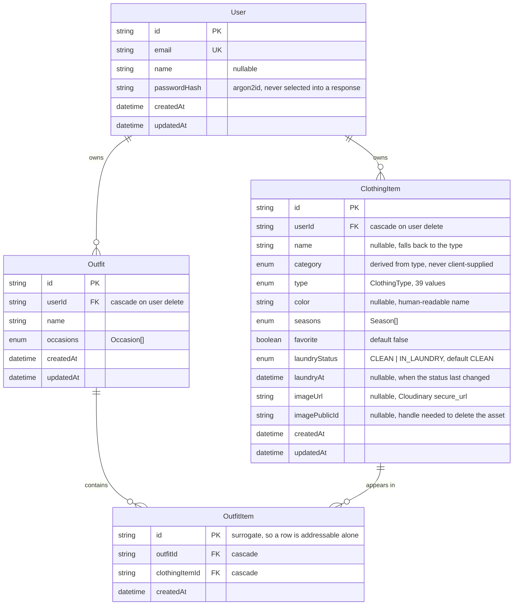
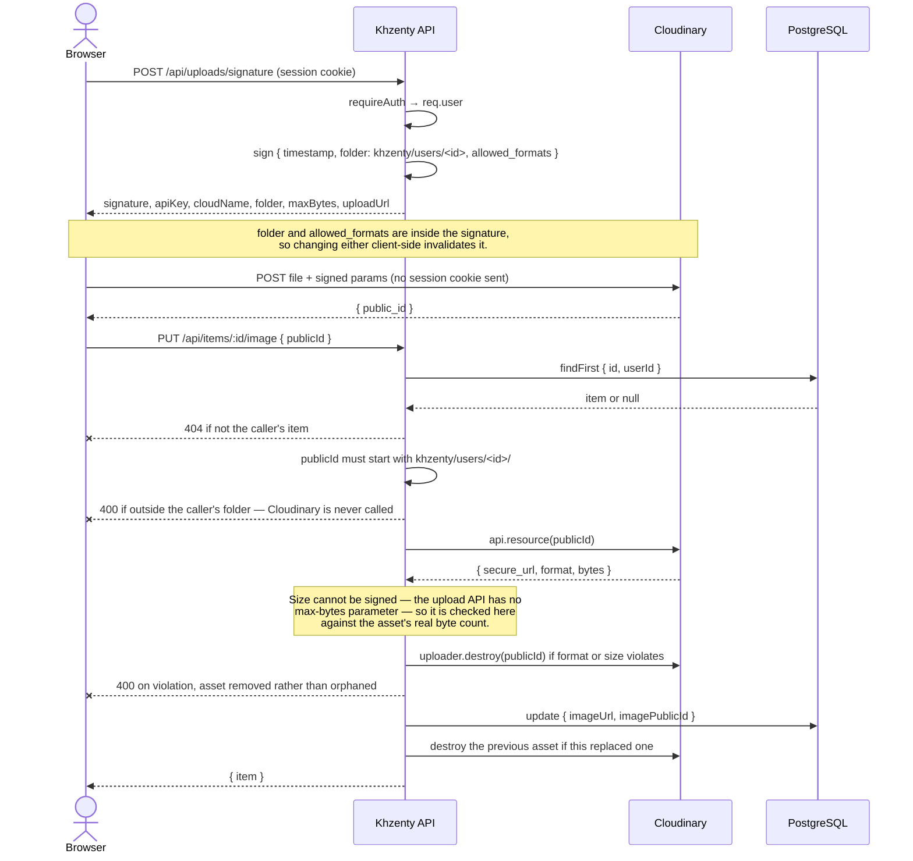
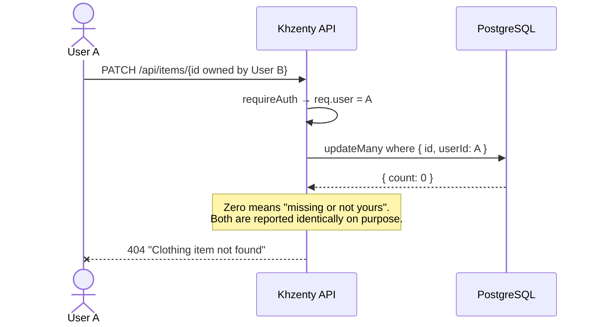

# Architecture

Generated from the code it describes: the ERD mirrors
`server/prisma/schema.prisma`, and the sequence diagrams trace the actual
handlers named in each step. If a diagram and the code disagree, the code is
right and this file is stale.

## Shape

Two independently installed packages plus a thin root that only orchestrates:

```
khzenty/
├── server/   Express 5 + Prisma 7 + PostgreSQL
├── client/   Vite 8 + React 19 + Tailwind v4
└── package.json   dev / build / test / lint across both
```

Requests flow in one direction only:

```
route → middleware → controller → service → Prisma
```

- **Routes** declare the HTTP surface and attach `requireAuth` and
  `validateBody`.
- **Controllers** are thin: read the request, delegate, shape the response.
  They hold no logic.
- **Services** hold the business rules and know nothing about `req`/`res`, so
  they are callable from tests and from each other.
- **`app.ts` builds the app without binding a port**; `server.ts` owns the port
  and graceful shutdown. That split is what lets Supertest drive the real app
  in-process.

## Data model



Notes the diagram cannot carry:

- **`Outfit` and `OutfitItem` have no endpoints yet.** They are modelled, and
  `ClothingItem` responses include `_count.outfitItems`, but nothing creates or
  reads outfits. The mounted routers are `/health`, `/auth`, `/items`,
  `/taxonomy`, `/uploads`.
- **`OutfitItem` is an explicit join**, not an implicit Prisma many-to-many, so
  it can later carry layer order or canvas position. `@@unique([outfitId,
  clothingItemId])` is the real key; the surrogate `id` exists so a single
  membership row can be addressed.
- **Indexes:** `ClothingItem` on `[userId]` and `[userId, category]` (the
  wardrobe grid filtered by category is the commonest read); `OutfitItem` on
  `[clothingItemId]`, which answers "which outfits use this garment?" before a
  delete.
- **Two invariants the database cannot express**, both enforced in services:
  `type` implies `category`, and `imageUrl`/`imagePublicId` are written and
  cleared together.

## Login

```mermaid
sequenceDiagram
    actor B as Browser
    participant RT as auth.routes
    participant V as validateBody
    participant CT as auth.controller
    participant SV as auth.service
    participant DB as PostgreSQL

    B->>RT: POST /api/auth/login { email, password }
    RT->>V: raw body
    V->>V: trim + lowercase email, then validate
    V--xB: 400 if malformed
    V->>CT: parsed input
    CT->>SV: login(input)
    SV->>DB: findUnique(email), selecting passwordHash
    DB-->>SV: record or null

    Note over SV: No user? Verify against a dummy digest<br/>anyway, so response time does not reveal<br/>whether the email is registered.

    SV->>SV: verifyPassword(digest, password)
    SV--xB: 401 "Invalid email or password"<br/>(identical for unknown email and wrong password)
    SV-->>CT: PublicUser — passwordHash was never projected
    CT->>CT: signSessionToken(user.id)
    CT-->>B: Set-Cookie httpOnly; SameSite=Lax<br/>expiry taken from the token's own exp claim<br/>+ { user }
```

The cookie's lifetime is read back off the signed token rather than recomputed,
so the two cannot drift apart.

## Signed upload, then confirm

Image bytes never reach the API.



Nothing the client reports about the file is trusted: the URL, format and byte
count all come back from Cloudinary.

## The ownership check

Every item query is scoped by `userId`. The interesting part is what a failure
looks like.



- `update` and `delete` use `updateMany`/`deleteMany` filtered on
  `{ id, userId }` rather than reading, comparing and then writing — the scope
  is part of the write, so there is no window between the check and the change.
- A **403 would confirm the id exists**. Returning the same 404 as a nonexistent
  id means probing reveals nothing.
- Bulk mark-as-washed takes the opposite approach deliberately: ids that are not
  yours are *skipped* rather than failing the batch, and the response reports
  how many rows actually moved.
- `requireAuth` re-reads the user on every request instead of trusting the
  token's claims, so a deleted account stops working immediately rather than at
  token expiry.

Guarded by tests that were mutation-checked: removing `userId` from the service's
where clauses fails six tests in the wardrobe suite and one in each laundry
scope.
